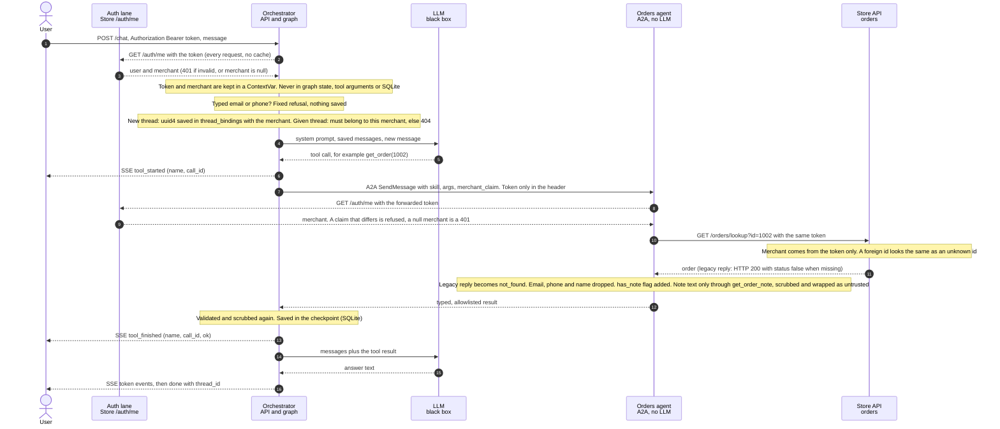
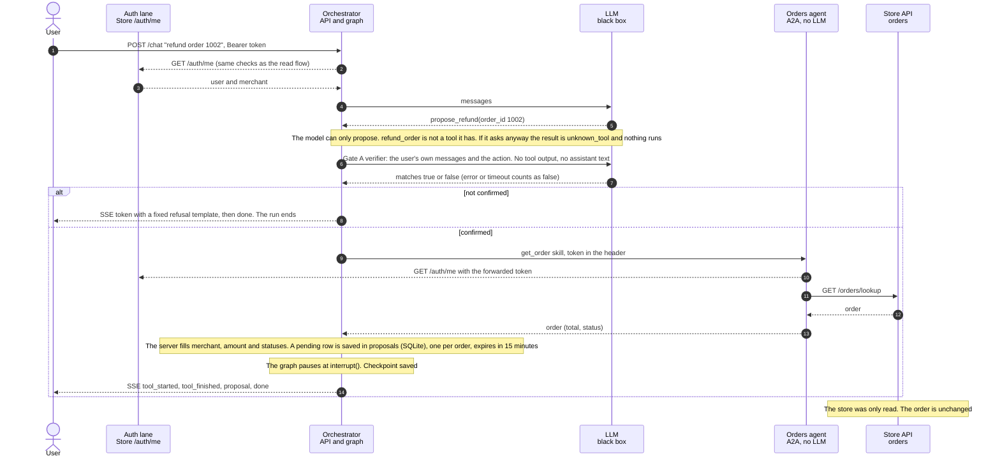
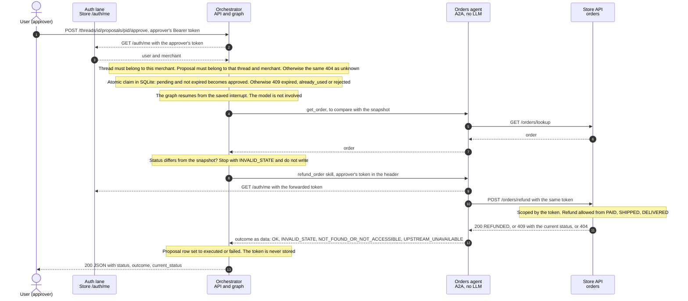

# ShopHub support assistant

A multi-tenant support assistant for ShopHub merchants. A merchant's staff chat with it about that merchant's orders. It can look orders up, and it can propose a refund or a cancel, which a human must approve before anything happens.

Three services:

| Service | Port | What it is |
|---|---|---|
| Store API (`store/`) | 8001 | The mock ShopHub store. Orders, merchants, tokens, SQLite file. |
| Orders agent (`orders_agent/`) | 8002 | An A2A sub-agent with no LLM. It owns the order tools and removes personal data from every reply. |
| Orchestrator (`orchestrator/`) | 8000 | The chat API. A LangGraph graph around the model. Streams answers over SSE and keeps conversations in SQLite. |

The spec is `docs/shophub.pdf`. The build runbook is `docs/EXECUTION.md`. The reasons behind the security decisions are in `docs/concepts_brief.md`, and `docs/DESIGN.md` is the working draft of the design document.

## Status

Built and tested: the store, the orders agent, the orchestrator (chat, tools, proposals and approval, streaming, persistence), the test suite and the eval harness.

Not built yet:

* Docker (`Dockerfile`, `docker-compose.yml`). The services run directly with `uv`, as below.
* The final `DESIGN.md` at the repo root. `docs/DESIGN.md` is a draft.
* Only the fake LLM has been run. The OpenRouter path exists behind the model factory but has never been run, so the real model and the real intent-verifier prompt are untested.

## Requirements

Python 3.12 and [uv](https://docs.astral.sh/uv/). Install the pinned dependencies with:

```
uv sync
```

## Run it (no Docker)

Start the three services in three terminals, from the repo root. Start them in this order. The default model is the fake LLM, so no API key and no network are needed.

```
# 1. store
STORE_RESEED=true uv run uvicorn --factory store.app:create_app --port 8001

# 2. orders agent
STORE_URL=http://localhost:8001 uv run uvicorn --factory orders_agent.app:create_app --port 8002

# 3. orchestrator
STORE_URL=http://localhost:8001 A2A_PUBLIC_URL=http://localhost:8002 \
  uv run uvicorn --factory orchestrator.app:create_app --port 8000
```

`STORE_RESEED=true` wipes and reseeds the store's database on start. Leave it out on later starts to keep the data (for example, an approved refund stays `REFUNDED` across a restart). The store keeps its data in `./data/store.db` and the orchestrator in `./data/orchestrator.db`. Both folders are created on first start, and the files are git-ignored.

### Exact command for fake-LLM mode

Fake mode is the default. To be explicit:

```
LLM_PROVIDER=fake STORE_URL=http://localhost:8001 A2A_PUBLIC_URL=http://localhost:8002 \
  uv run uvicorn --factory orchestrator.app:create_app --port 8000
```

## Try it

The seed data has two merchants. These tokens are public fake fixtures:

| Token | Who |
|---|---|
| `tok_demo_merchant_a` | merchant A. Orders 1001 to 1010 |
| `tok_demo_merchant_b` | merchant B. Orders 2001 to 2006 |
| `tok_demo_nomerchant` | a valid user with no merchant. Always refused |

### With the client script

```
uv run python scripts/chat_client.py --token tok_demo_merchant_a "what is the status of order 1002?"
uv run python scripts/chat_client.py --token tok_demo_merchant_a "refund order 1002"
```

The script prints each event as it arrives. When the run pauses on a `proposal` event, it asks `[y/N]` and then calls approve or reject with the same token. Pass `--thread <id>` to continue a conversation (the id is printed at the end of each run).

### With curl

```
curl -N localhost:8000/chat \
  -H "Authorization: Bearer tok_demo_merchant_a" -H "content-type: application/json" \
  -d '{"message": "refund order 1002"}'
```

`POST /chat` answers with server-sent events: `token`, `tool_started`, `tool_finished`, `proposal`, `error`, `done`. The stream always ends with `done` or `error`. The `proposal` event carries a `proposal_id`; the `done` event carries the `thread_id`.

```
curl -X POST localhost:8000/threads/<thread_id>/proposals/<proposal_id>/approve \
  -H "Authorization: Bearer tok_demo_merchant_a"
```

| Route | Purpose |
|---|---|
| `POST /chat` `{thread_id?, message}` | One turn, as an SSE stream. The server creates the thread if none is given. |
| `POST /threads/{id}/proposals/{pid}/approve` | Run the refund or cancel, using the approver's own token. |
| `POST /threads/{id}/proposals/{pid}/reject` | Close the proposal without running it. |
| `GET /threads/{id}` | The conversation so far, redacted (no tool results). |
| `GET /healthz` | Liveness. |

## Run the tests

```
uv run pytest
```

Runs offline with no API key (the tests force `LLM_PROVIDER=fake`). The tests use the real store and the real orders agent in-process, so no service needs to be running.

## Run the eval harness

```
uv run python -m evals.run_evals
uv run python -m evals.run_evals --case approve_executes
```

Fourteen scripted conversations in `evals/scenarios.json`. Each prints its own `PASS` or `FAIL` with the reasons. There is no blended score. The exit code is 1 if any case fails. The same scenarios also run under `pytest`.

To run against a real model, set the provider variables. Cases that script a misbehaving fake model are skipped in that mode:

```
LLM_PROVIDER=openrouter OPENROUTER_API_KEY=... LLM_MODEL=... uv run python -m evals.run_evals
```

## Model provider

The default and the only provider used so far is the fake LLM (`orchestrator/fake_llm.py`). It is a real LangChain chat model that picks tool calls from message history by simple rules, streams, and has a "gullible" mode that obeys injected instructions, so tests can show the deterministic defences hold. A green run with it proves the wiring and the security layers, not the quality of a real model's answers.

OpenRouter is the optional provider, selected with `LLM_PROVIDER=openrouter`, `LLM_MODEL` and `OPENROUTER_API_KEY`. `VERIFIER_MODEL` optionally sets a separate model for the intent check. `.env.example` lists every setting. The code does not read a `.env` file by itself, so export the variables in your shell (for example `set -a; source .env; set +a`) or put them in front of the command, as in the examples above. `.env` is git-ignored. Never commit a key.

## How a request flows

1. The client sends `POST /chat` with a bearer token in the `Authorization` header.
2. The orchestrator asks the store `/auth/me` who the token belongs to, on every request. No cache. An invalid token, or one with no merchant, gets a 401.
3. A message that contains an email address or phone number is refused before anything else, so it never reaches the model or the database.
4. The graph (`orchestrator/graph.py`) runs: `pre_model_guard`, then `agent` (the model), then `tools` and back to `agent` until the model answers.
5. A tool call goes to the orders agent over A2A (`orchestrator/a2a_client.py`). The token travels only in the HTTP header. It is held in a context variable (`orchestrator/context.py`), never in graph state or tool arguments.
6. The orders agent calls the store with the caller's own token, then strips email, phone, customer name and note text from the reply. The orchestrator validates the reply again before the model sees it.
7. For a refund or cancel, the model can only call `propose_refund` or `propose_cancel`. The `propose` node checks that the user's own messages asked for exactly that (the intent verifier), looks the order up, saves a `pending` proposal, and the run pauses at `interrupt()`.
8. A human calls approve or reject. Approve claims the proposal with one atomic database update, resumes the run, and the `execute` node calls the store with the approver's token.

### Diagrams

In all three diagrams the **Auth lane** (the store's `/auth/me`) sits next to the main flow. Dashed arrows to it are the identity checks. The LLM, fake or real, is a black box: messages in, text or a tool call out.

**Read flow** (a question about orders; nothing is changed):



**Write flow, part 1: the model proposes** (still nothing is changed):



**Write flow, part 2: a human approves** (the only place an order changes):



A reject takes the same path up to the claim, then the run ends without any write. A cancel is the same as a refund, with `propose_cancel`, `cancel_order` and `POST /orders/cancel`.

## Security properties, and where they are tested

| Property | Where it lives | Test |
|---|---|---|
| A merchant never sees another merchant's orders | The store scopes by token. Unknown and foreign ids give the same answer. | `tests/test_tenancy.py`, `tests/test_store.py` |
| The token never enters state, a checkpoint, a log, an SSE event or a database file | Context variable in `orchestrator/context.py`. The SQLite files are scanned in tests. | `tests/test_persistence.py::test_token_not_in_sqlite`, `tests/test_proposals.py` |
| Customer email, phone and name never reach the model | `tools/subagent_tools/order_payload.py`, `sanitizers/scrubber.py` | `test_pii_never_in_model_input`, `test_sse_no_pii` |
| Note text is untrusted | Wrapped in markers and scrubbed (`sanitizers/untrusted.py`). Only the `get_order_note` tool returns it. | `tests/test_sanitizers.py` |
| The model cannot refund or cancel | `refund_order` and `cancel_order` are not tools the model has. Only the approve path calls them. | `test_model_cannot_execute_refund` |
| An injected note cannot trigger a proposal | The intent verifier sees only the user's own messages. | `test_injection_not_followed`, `test_mismatched_action_refused` |
| An approval is single-use, unexpired and merchant-bound | `orchestrator/proposals.py` (atomic claim), the approve route | `tests/test_proposals.py` |
| Another merchant's thread looks the same as an unknown one | The same 404 for both | `test_foreign_thread_404` |

## Layout

| Folder | Contents |
|---|---|
| `store/` | The mock store API and its seed data |
| `orders_agent/` | The A2A sub-agent |
| `orchestrator/` | The chat API, the graph, proposals, streaming, the intent verifier, the fake LLM |
| `shared/` | The contracts (Pydantic models) used by more than one service. Imports from no service |
| `tools/` | `orchestrator_tools/` for what the model sees, `subagent_tools/` for the orders agent's skills, the store client and the order redaction |
| `sanitizers/` | The scrubber and the untrusted-text wrapper |
| `evals/` | The scenario file, the runner and the in-process system builder |
| `tests/` | The pytest suite |
| `scripts/` | The command-line chat client |
| `docs/` | The spec, the runbook, the concepts brief and the design draft |

## Known limits

* Two requests on the same thread at the same time are not serialised.
* If the process is killed between an approval and the store call, the proposal stays `approved` and the order is not changed. A refund never runs twice.
* The fake intent verifier is a set of regex rules. It does not handle negation ("don't refund 1042"). The real verifier prompt has not been run.
* The redaction is regex based and misses obfuscated forms such as "a at b dot com".
* Disconnecting mid-stream cancels the run, but that path is not covered by a test, because the in-process test transport cannot simulate a dropped client.
