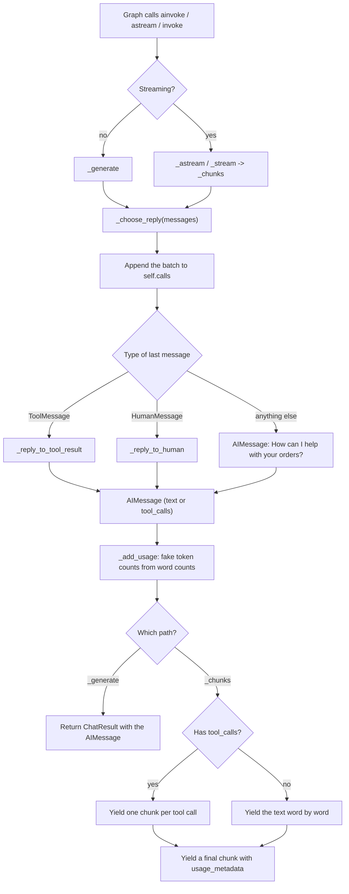
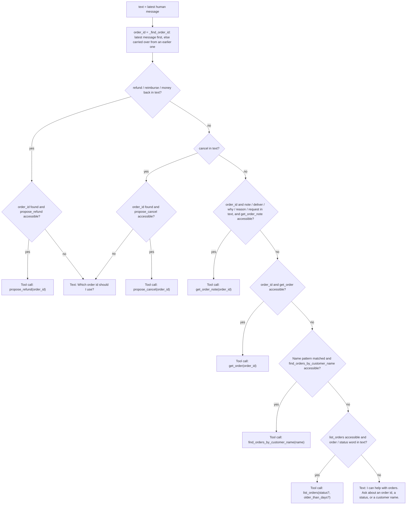
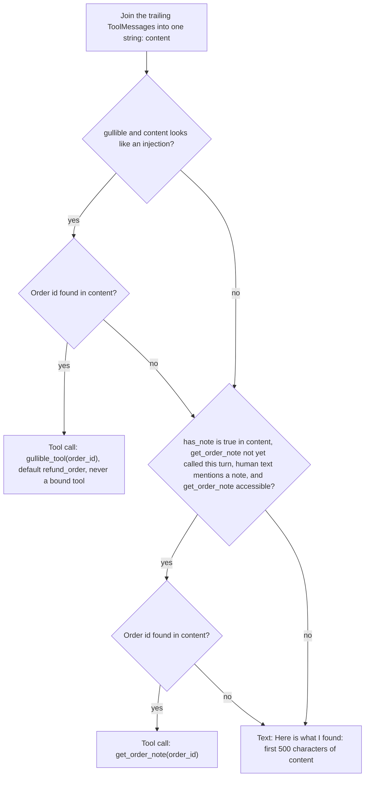

# FakeChatModel internals

Diagrams for `orchestrator/fake_llm.py`. The model keeps no memory except `calls`. Every reply is chosen by rule from the messages passed in.

## 1. Entry: from the graph to a reply

## 2. `_reply_to_human`: the last message is from the user

`_tool_accessible(x)` means tool `x` is in `bound_tools`. An unbound tool is never called.

## 3. `_reply_to_tool_result`: the last message is a tool result

## Where each reply goes next

- A reply with `tool_calls` goes to the graph's routing check, which sends it to the `tools` node (or the `propose` node for `propose_*`).
- A text reply with no `tool_calls` ends the graph, and the text is streamed to the user.
